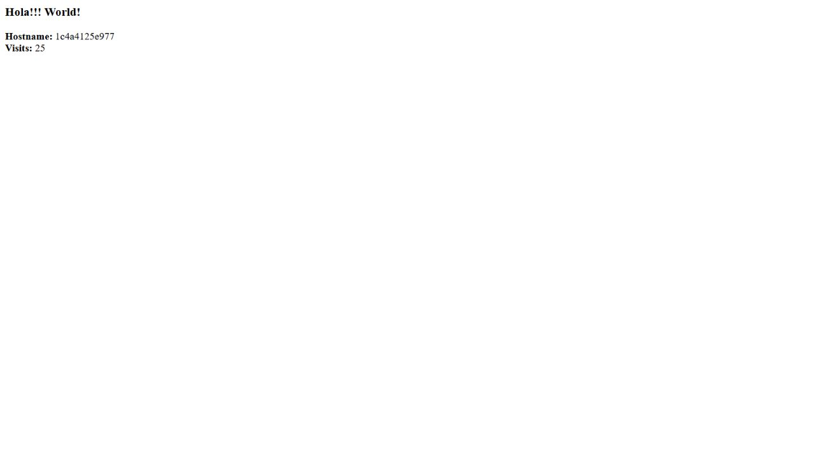
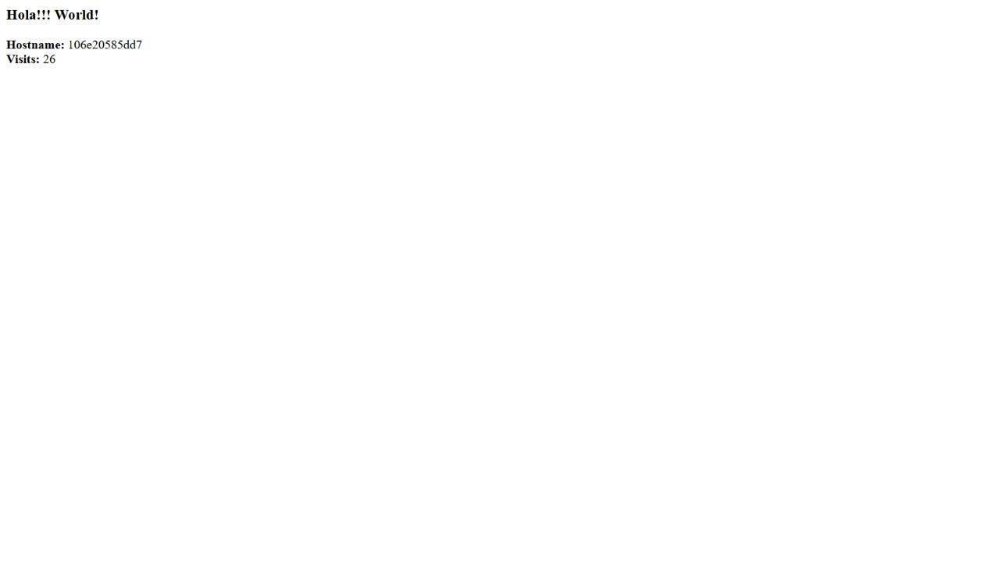
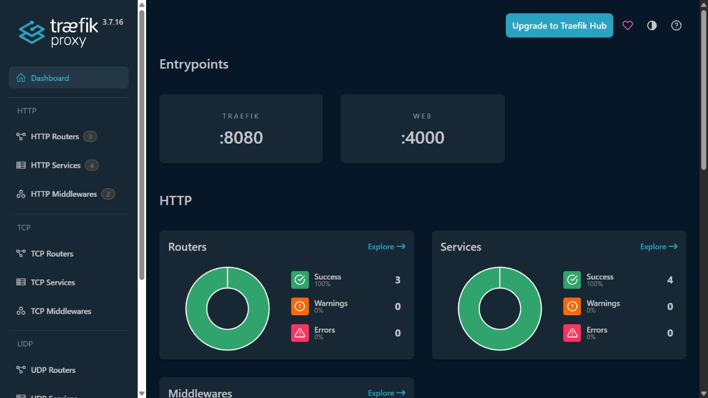
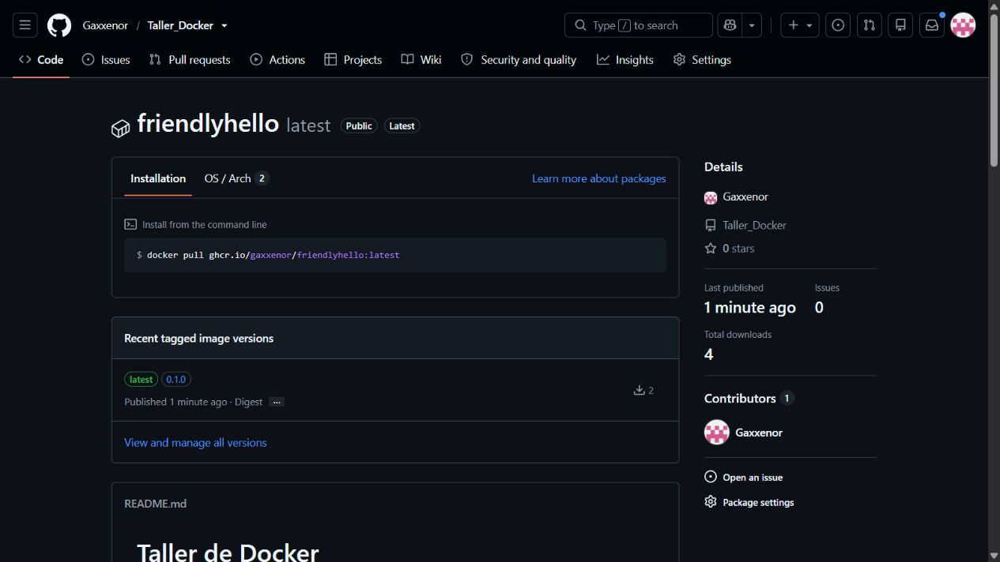
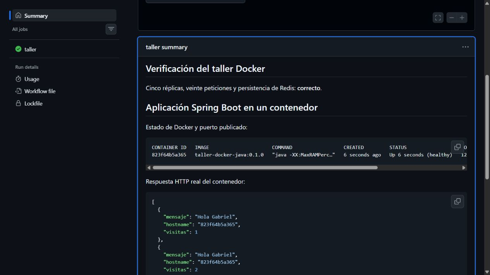

# **Taller de Docker**

**Trabajo individual · 18 de noviembre de 2026**

Repositorio: [Gaxxenor/Taller\_Docker](https://github.com/Gaxxenor/Taller_Docker). Guía: [DYAS-Docker](https://github.com/CesarAVegaF312/DYAS-Docker).

Este informe documenta los resultados reales de la ejecución local 20261118-223124 y de las pruebas de Docker en GitHub Actions. Autor: Gabriel Gonzalez. Correo institucional: gabrielgoso@unisabana.edu.co.

## **1\. Construcción de imágenes**

La imagen helloapp:v1 parte de busybox:1.37, copia el archivo hello y muestra su contenido mediante RUN cat /hello. La aplicación friendlyhello utiliza python:3.14-slim, Flask 3.1.3, redis 8.1.0 y Gunicorn 26.2.0.

El Dockerfile instala las dependencias antes de copiar el código. Ejecuta Gunicorn con dos workers en el puerto 8000 y utiliza el usuario app. El archivo .dockerignore excluye datos de Redis, Git, bytecode, archivos Compose y variables locales .env.

**Validación:** docker build \--check terminó con “Check complete, no warnings found.” La consulta del usuario devolvió uid=999(app), gid=999(app), groups=999(app). El endpoint /health permite comprobar el servidor sin depender de Redis. La ejecución independiente también mostró correctamente el aviso de contador deshabilitado al no disponer de Redis.

## **2\. Caché de capas**

Se compararon dos contextos aislados. Primero se construyó cada imagen; después se cambió únicamente el saludo y se midió la reconstrucción. El código del taller se mantuvo intacto durante esta comparación.

| Orden del Dockerfile | Tiempo | Instalación de dependencias |
| ----- | ----- | ----- |
| Dependencias antes del código | 2,252 s | RUN pip install: CACHED |
| COPY de todo antes de pip | 13,053 s | RUN pip install se ejecutó de nuevo: 9,8 s |

La diferencia fue de 10,801 s; en esta medición la reconstrucción optimizada tomó aproximadamente 5,8 veces menos tiempo. El resultado corresponde al equipo y caché de esta ejecución, no a un benchmark general.

## **3\. Compose, Redis y persistencia**

La aplicación se conecta a Redis usando el nombre del servicio redis en la red de Compose. El contador utiliza la operación atómica INCR. depends\_on con service\_healthy espera que Redis responda al comando redis-cli ping.

El listado de Compose mostró web y redis en estado healthy. Dos solicitudes consecutivas devolvieron visitas 1 y 2\. Después de detener y recrear los contenedores, el contador continuó en 3 con otro hostname. Esto verifica la persistencia fuera de la capa de escritura del contenedor. Las pruebas utilizaron un volumen aislado para conservar los datos previos del taller.

## **4\. Balanceo con cinco réplicas**

Traefik recibe las peticiones y las distribuye a cinco réplicas web saludables en el puerto interno 8000\. La regla del router utiliza el nombre localhost. Todas las instancias comparten el contador de Redis.

Las veinte peticiones registradas recorrieron estos cinco hostnames: 5022d6112a86, 1c4a4125e977, b3d9d4dec7d4, 106e20585dd7 y ed2f80bbdc82. Cada uno atendió cuatro solicitudes y el contador avanzó de 4 a 23\.

El despliegue de evidencia usa http\://localhost:4002 y el dashboard http\://localhost:8082/dashboard/, publicados únicamente en la interfaz local. No interfiere con el puerto 4000 del taller original.

**Captura 1:** hostname 5022d6112a86, visita 24\.

**Captura 2:** hostname 1c4a4125e977, visita 25\.

**Captura 3:** hostname 106e20585dd7, visita 26\.

**Dashboard:** Traefik 3.7.16 mostró tres routers y cuatro servicios habilitados, sin advertencias ni errores.

## **5\. Registro y ejercicios**

Se publicaron las imágenes en GitHub Container Registry (GHCR), alternativa contemplada en la guía. Las páginas de [friendlyhello](https://github.com/Gaxxenor/Taller_Docker/pkgs/container/friendlyhello) y [taller-docker-java](https://github.com/Gaxxenor/Taller_Docker/pkgs/container/taller-docker-java) muestran visibilidad pública y etiquetas 0.1.0 y latest. La publicación se realizó mediante GitHub Actions con un token temporal del workflow.

Imágenes: ghcr.io/gaxxenor/friendlyhello:0.1.0 y ghcr.io/gaxxenor/taller-docker-java:0.1.0.

**Ejercicio 1 verificado.** docker-compose.registro.yaml utiliza image y no contiene build. La [ejecución de CI 44455711403](https://github.com/Gaxxenor/Taller_Docker/actions/runs/44455711403) descargó la imagen con \--pull always, levantó web y redis como healthy y comprobó el contador de visitas 1 → 2\. Los registros se adjuntan como artefactos de esa ejecución.

**Ejercicio 2\.** La guía pide usar la imagen de un compañero. Como el trabajo es individual y no se proporcionó una imagen de otro autor, queda por aclarar con el docente la alternativa; no se declara resuelto.

**Imagen pública en GHCR con etiquetas de versión y latest:**

****

## **6\. Aplicación Java y entrega oficial**

Se creó una aplicación Spring Boot individual en proyecto-java/ porque no se disponía de un proyecto previo del curso. Usa Java 21 y Spring Boot 4.1.2. La ruta / devuelve un saludo configurable con APP\_NAME, el hostname y un contador en memoria. El endpoint /actuator/health/readiness informa si el servidor está listo. Esta aplicación se creó para el taller; si el docente exige utilizar el proyecto previo del curso, debe confirmar que acepta esta alternativa.

**Dockerfile multi-stage.** La etapa Maven compila y ejecuta mvn verify. La etapa final utiliza únicamente un JRE y copia target/app.jar. La aplicación corre con el usuario app y un HEALTHCHECK real; .dockerignore excluye Git, resultados de compilación y archivos .env. Compose limita la memoria del contenedor a 512 MB y publica el puerto 8083 del equipo hacia 8080 del contenedor.

**Resultados reales.** Las dos pruebas HTTP pasaron sin fallos ni errores, tanto localmente como en la construcción Docker. GitHub Actions ejecutó el contenedor 823f64b5a365 como healthy y confirmó uid=999(app), gid=999(app). Dos consultas HTTP devolvieron Hola Gabriel, el mismo hostname y visitas 1 y 2\. Readiness respondió UP.

**Captura del resumen de CI con el estado de Docker y las respuestas HTTP del contenedor:**

****

La documentación oficial se publicó en la [Wiki del repositorio](https://github.com/Gaxxenor/Taller_Docker/wiki), con las secciones Inicio, Imágenes, Caché de capas, Compose, Balanceo, Registro, Proyecto y Reflexión final. El informe de avance también está disponible en una pestaña separada del Google Docs enlazado desde el README.

## **7\. Reflexión técnica**

**Imagen y contenedor.** Una imagen es una plantilla de capas de solo lectura; un contenedor es una instancia con sus procesos y una capa de escritura propia. Al eliminarlo se pierde esa capa. Los volúmenes permiten conservar datos independientemente del ciclo de vida del contenedor, como se verificó con el contador de Redis.

**Orden de construcción.** Cambiar un archivo copiado invalida la capa correspondiente y las posteriores que dependen de ella. Separar dependencias y código evita reinstalar librerías por cambiar el saludo. Los tiempos medidos y el paso CACHED respaldan esta decisión.

**Disponibilidad.** Cinco réplicas en un equipo reparten carga y pueden tolerar el fallo de una instancia, pero todas dependen de la misma máquina. Redis y Traefik también son instancias únicas. La alta disponibilidad requiere distribuir componentes entre dominios de fallo y resolver la disponibilidad del almacenamiento y el balanceador.

**Seguridad.** Un usuario sin privilegios reduce el alcance de acciones de un proceso comprometido. Una construcción multi-stage evita distribuir compiladores, Maven y código fuente en la imagen final. Estas prácticas reducen componentes y permisos, pero no sustituyen las actualizaciones ni la revisión de vulnerabilidades. El dashboard sin autenticación y el acceso al socket de Docker corresponden únicamente a esta demostración local.

## **8\. Evidencias disponibles**

Se conservaron los logs de construcción, revisión del Dockerfile, usuario de ejecución, Compose y balanceo; tiempos.csv; balanceo.csv; las respuestas HTML del contador antes y después de recrear los contenedores; y la respuesta de la API de servicios de Traefik.

Material base: César Augusto Vega Fernández, Universidad de La Sabana; partes basadas en Aula de Software Libre. Adaptación educativa bajo CC BY-NC-SA 4.0.
